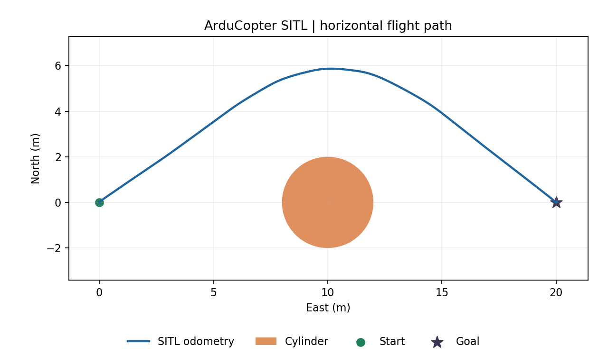

# 開發日誌

## 2026-11-24｜四旋翼首次完成航點導航與水平避障

在 Ubuntu 20.04.6 的 WSL 2 工作區中沿用 ROS 2 Foxy，透過 MAVLink 2 連上 ArduCopter 4.7.3 SITL。這個版本用內建四旋翼動力學與理想化水平雷射，先驗證一個可以量測的問題：當起點與航點之間有圓柱擋路，飛控能否自行找到繞行路線？

### 實作紀錄

1. 固定 SITL 韌體、配套的四旋翼參數與 pymavlink 版本。安裝腳本以 SHA-256 核對下載的韌體和參數檔。
2. 將飛控的位置與姿態轉成 ROS 2 里程計，水平座標為東、北。模擬雷射沿機體四周每隔 5° 發出一條射線。橋接節點將量測轉為飛控使用的機體方向與公分距離。
3. 在 GUIDED 模式啟用航點導航與水平 BendyRuler。任務只送一個位於東側 20 公尺、高 5 公尺的目的地。繞行方向由飛控根據掃描資料決定。
4. 整合測試發現套件索引未註冊及橋接節點啟動失敗，分別修正 ROS 套件維護者欄位與覆蓋 Foxy `Node.handle` 的方法名稱，並加入實際建立 Foxy 節點的回歸測試。

### 飛行驗證

圓柱中心在東側 10 公尺，半徑 2 公尺。兩次飛行均從新的 SITL 狀態起跑，完成起飛、繞行、進入航點範圍、降落與馬達解除鎖定。

| 台北時間的執行起點 | 飛機中心到柱面的最近水平距離 | 經過圓柱附近的最大側向偏移 | 任務結果 |
| --- | ---: | ---: | --- |
| 22:25:45 | 3.74 m | 5.87 m | succeeded |
| 22:27:59 | 3.72 m | 5.86 m | succeeded |

最近距離以每筆里程計座標到圓心的水平距離減去半徑計算。任務要求柱面淨距大於 0.5 公尺，並在圓心東西向前後 4 公尺的範圍內觀察到至少 2.5 公尺側移。第二趟共收到 553 筆里程計資料，最後一筆的位置距目標水平約 0.034 公尺。這些數值來自單一靜態圓柱的模擬場景。



第二趟的原始資料與任務狀態時間可交叉查閱。[里程計 CSV](docs/runs/2026-11-24/trajectory.csv) · [任務日誌](docs/runs/2026-11-24/mission.log)

### 重現

在 WSL 工作區執行 `bash tools/run_demo.sh`。下列指令可在完成一次建置後重跑 10 項測試，涵蓋圓柱測距、座標與角度換算、節點初始化，以及任務成功和碰撞判定。本次全部通過。

```bash
source /opt/ros/foxy/setup.bash
source install/local_setup.bash
ROS_DOMAIN_ID=53 ROS_LOCALHOST_ONLY=1 runtime/venv/bin/python -m unittest discover -s tests -v
```

### 飛行影片回放

第二趟飛行的 ROS 2 里程計提供 553 筆位置，飛控 DataFlash 提供空中姿態。影片依時間戳內插，以原速從第一筆里程計播放到降落解除鎖定，片尾停留約 1.75 秒。俯視圖標出圓柱的水平範圍，斜視圖以有限高度畫出模擬中的圓柱。地面姿態在飛控資料涵蓋範圍以外時沿用最近一筆。輸出為 1280 × 720、24 fps 的 H.264 影片。[飛行回放（MP4）](docs/runs/2026-11-24/flight-replay.mp4)
