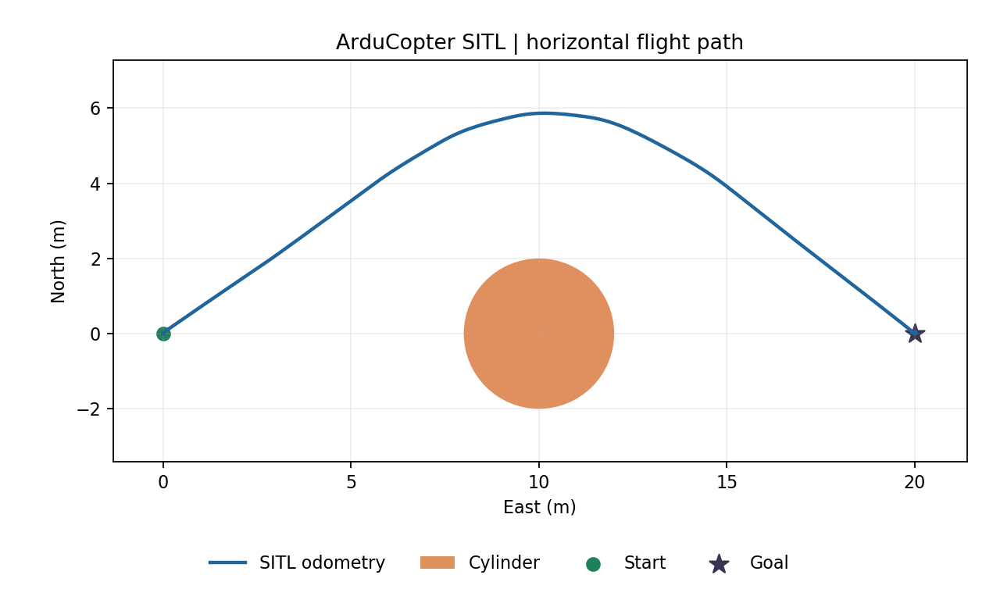

# ROS 2 與 ArduCopter 自主導航避障模擬

讓一架模擬四旋翼從原點起飛到 5 公尺高，前往東側 20 公尺的航點。航線正中央有一根半徑 2 公尺的圓柱，圓心在原點東側 10 公尺。ROS 2 的模擬雷射提供障礙物距離，ArduCopter 的 BendyRuler 在飛行中選擇繞行方向，到達航點後降落。[ArduPilot BendyRuler 說明](https://ardupilot.org/copter/docs/common-oa-bendyruler.html)



[觀看 Gazebo 相機原片（MP4，43 秒）](https://github.com/yeyi58095/uav_nav_ws/raw/refs/heads/main/docs/runs/2026-11-24/gazebo/flight.mp4) · [觀看第二趟航跡回放（MP4，40 秒）](https://github.com/yeyi58095/uav_nav_ws/raw/refs/heads/main/docs/runs/2026-11-24/flight-replay.mp4)

## 執行模擬

本專案使用 WSL 2 的 Ubuntu 20.04（x86_64）及 ROS 2 Foxy，透過 MAVLink 連接本機 ArduCopter 4.7.3 SITL（軟體迴路模擬器）。[ArduPilot SITL 說明](https://ardupilot.org/dev/docs/sitl-simulator-software-in-the-loop.html)

請先確認已安裝 Foxy、`colcon`、`curl`、`python3-venv`、`python3-pip` 和繪圖用的 `python3-matplotlib`。在 WSL 終端執行下列指令。

```bash
cd ~/uav_nav_ws
bash tools/run_demo.sh
```

首次執行會下載並驗證 SITL 執行檔與預設參數，並在 `runtime/venv` 安裝 `pymavlink`。接著腳本用 colcon 建置 `uav_nav`、啟動飛控與 ROS 2 節點、執行任務。若要預先準備執行環境，可以先執行 `bash tools/setup_sitl.sh`。

每次執行的資料各自存於 `runtime/runs/` 下的子目錄。開啟 `trajectory.png` 可看繞行路線，`trajectory.csv` 可用來分析軌跡。`mission.log` 記錄每個任務階段及時間，`sitl.log` 與 `ros/` 保留飛控和節點輸出。

## 用 Gazebo 飛行並錄影

在同一個 WSL 工作區執行以下指令，ArduCopter 會透過本機外掛驅動 Gazebo 裡的四旋翼 Iris。Gazebo 計算機體運動及地面接觸，既有 ROS 2 節點根據位置計算模擬雷射距離。場內北側的固定相機會從解鎖階段錄到降落。

```bash
bash tools/run_demo.sh --gazebo-camera
```

這個模式使用 Gazebo Classic 11、開發套件 `libgazebo11-dev`、Foxy 的 `gazebo_ros_pkgs`、Git、CMake、C++ 編譯器、Python OpenCV 及 FFmpeg。WSLg 或 Linux 圖形環境需可供 Gazebo 建立 OpenGL 相機。首次啟動會下載並在工作區編譯 Iris 的 ArduPilot 外掛。完整錄影位於該次執行目錄中的 `gazebo-camera.mp4`，與飛控及 Gazebo 日誌存放在一起。

## 觀察飛行與避障

模擬執行期間，可在同一個 WSL 發行版另開終端讀取任務狀態。

```bash
source /opt/ros/foxy/setup.bash
export ROS_DOMAIN_ID=44 ROS_LOCALHOST_ONLY=1
ros2 topic echo /uav/mission_status
```

| ROS 2 主題 | 訊息型別 | 可觀察的資料 |
| --- | --- | --- |
| `/uav/odom` | `nav_msgs/msg/Odometry` | `sitl_bridge` 將飛控估計的位置轉為東、北、上座標，供 `sim_lidar` 定位 |
| `/uav/scan` | `sensor_msgs/msg/LaserScan` | `sim_lidar` 每隔 5° 取樣一次，共 72 個方向。`sitl_bridge` 將掃描轉為 MAVLink `OBSTACLE_DISTANCE` 傳回飛控 |
| `/uav/mission_status` | `std_msgs/msg/String` | `sitl_bridge` 發布目前任務階段，最後回報 `succeeded` 或 `failed` |

這個案例使用水平二維掃描，量測範圍為 0.2 到 20 公尺。圓柱在所有高度都存在，模型忽略感測器雜訊和延遲，適合驗證單一靜態障礙物的水平繞行。專案執行紀錄與驗證結果見 [開發日誌](DEVELOPMENT_LOG.md)。
